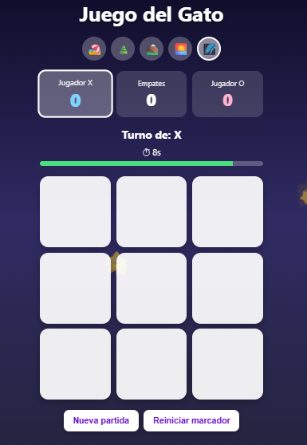
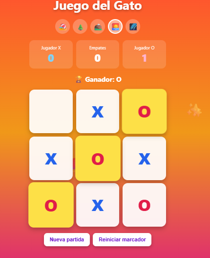
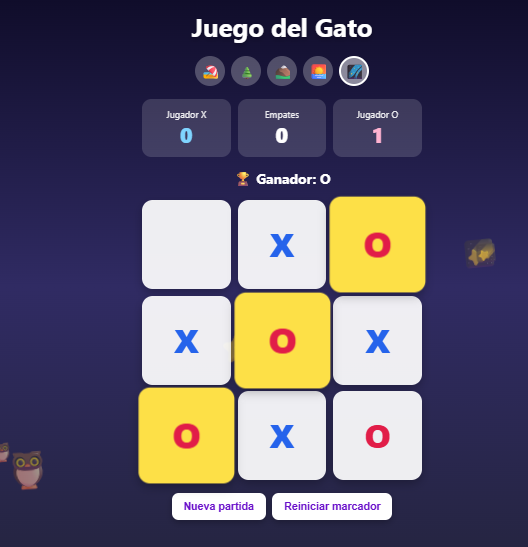

# 🎮 Juego del Gato con React
🎮 **[¡Juega aquí!](https://juego-gato-react-nine.vercel.app/)**
Juego de gato (tic-tac-toe) para dos jugadores, hecho con **React** y **Vite**. Tiene marcador, temporizador por turno y temas de fondo con emojis animados para cambiar el ambiente de la partida.

> Proyecto de tarea libre sobre React.js para la materia [nombre de la materia].

## 📸 Capturas

| Inicio | Partida ganada | Tema nocturno |
|:---:|:---:|:---:|
|  |  |  |

## ✨ Características

- **Dos jugadores (X y O)** con turnos alternados.
- **Detección automática** de ganador y de empate.
- **Marcador** de victorias de X, de O y de empates.
- **Temporizador de 10 segundos por turno**: si se acaba el tiempo, el turno pasa al otro jugador.
- **5 temas de fondo** (playa, bosque, montañas, atardecer y noche) hechos con degradados de color y emojis flotando.
- **Resaltado de la línea ganadora** y botones para iniciar una nueva partida o reiniciar el marcador.

## ⚛️ ¿Por qué React?

React es una biblioteca de JavaScript para construir interfaces de usuario con **componentes** reutilizables. En este proyecto se usan:

- **Componentes:** `App` (el juego completo) y `Square` (cada casilla).
- **`useState`:** guarda el tablero, el turno, el marcador, el tiempo restante y el tema elegido.
- **`useEffect`:** controla el temporizador y el cambio de fondo.
- **Renderizado de listas:** las casillas y los botones de tema se generan con `.map()`.

### 📈 Demanda en el mercado laboral

Según el estudio de [DevJobsScanner](https://www.devjobsscanner.com/blog/the-most-demanded-frontend-frameworks/), que analizó unas 500 mil ofertas de trabajo front-end entre noviembre de 2022 y diciembre de 2023, React es el framework más pedido:

| Framework | Porcentaje de ofertas |
|---|:---:|
| React | ~50% |
| Angular | ~38% |
| Vue | ~11% |
| Otros | ~2% |

El mismo estudio ubica a React como el mejor pagado en Estados Unidos, con un salario promedio anual de unos 116 mil dólares. Esa demanda es una de las razones por las que vale la pena aprenderlo.

## 🛠️ Tecnologías

- [React](https://react.dev/)
- [Vite](https://vite.dev/)
- JavaScript (JSX)
- CSS3

## 🚀 Cómo ejecutarlo en tu computadora

**Requisitos:** tener instalado [Node.js](https://nodejs.org/) (versión LTS) y [Git](https://git-scm.com/).

```bash
# 1. Clonar el repositorio
git clone https://github.com/luistunas7874-droid/juego-gato-react.git

# 2. Entrar a la carpeta
cd juego-gato-react

# 3. Instalar las dependencias
npm install

# 4. Iniciar el servidor de desarrollo
npm run dev
```

Abre en el navegador el link que aparece en la terminal (normalmente `http://localhost:5173/`).

## 📁 Estructura del proyecto

```
juego-gato-react/
├── capturas/        # Imágenes para este README
├── public/          # Archivos estáticos
├── src/
│   ├── App.jsx      # Lógica y componentes del juego
│   ├── App.css      # Estilos del juego
│   ├── index.css    # Estilos globales
│   └── main.jsx     # Punto de entrada de React
├── index.html
└── package.json
```

## 📚 Recursos utilizados

- [Documentación oficial de React](https://react.dev/)
- [Tutorial: Tic-Tac-Toe](https://react.dev/learn/tutorial-tic-tac-toe)
- [Frontend frameworks más demandados (DevJobsScanner)](https://www.devjobsscanner.com/blog/the-most-demanded-frontend-frameworks/)

## 👤 Autor

**Luis Andres Tuñas Esparza**
GitHub: [@luistunas7874-droid](https://github.com/luistunas7874-droid)